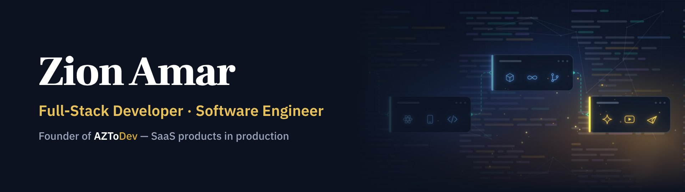
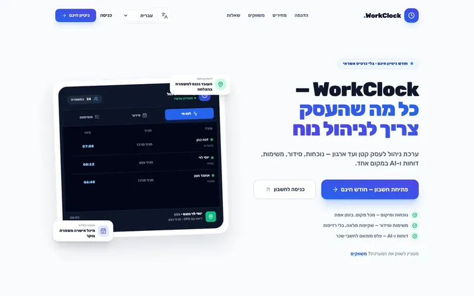
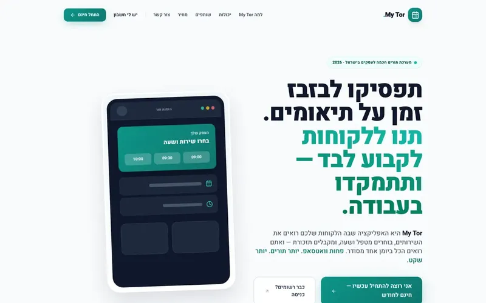
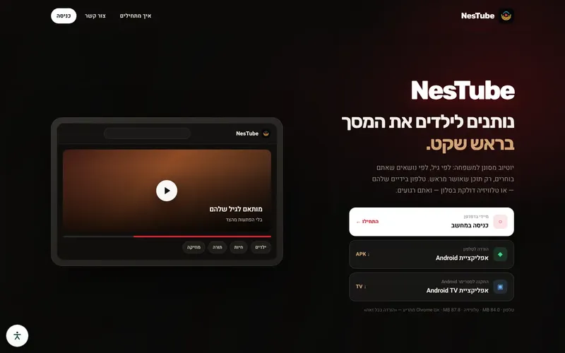
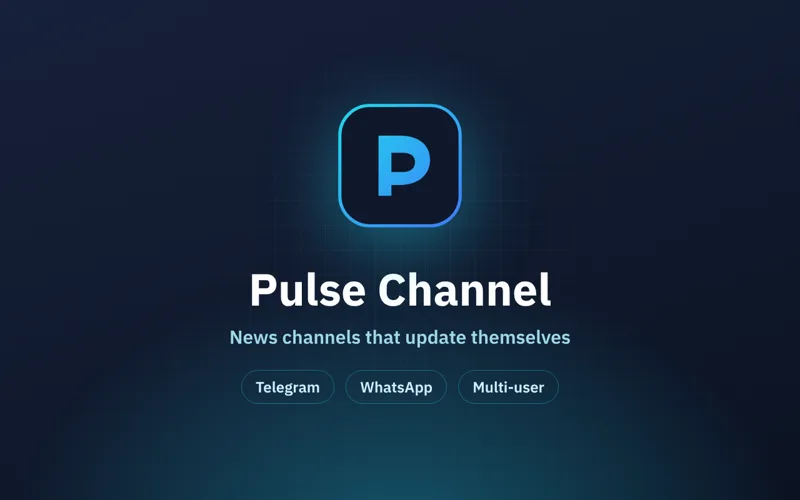

## About

I'm a full-stack developer and software engineering graduate (with honors) from Israel. I build products end to end — spec, design, backend, frontend, deployment and support — under my own brand, **AZToDev**.

- **Today:** software developer at Yael Group, building data-driven apps and dashboards.
- **AZToDev:** I build and run SaaS products that real businesses use every day.

## Products I've built

Most of my products are commercial, so their code is private. Each one has a showcase repository with screenshots and details.

<table>
<tr>
<td width="50%" valign="top">

<h3><a href="https://github.com/ZionAmar/workclock-pro">WorkClock Pro</a></h3>
Attendance, scheduling, tasks and reports — in one system, from any phone. 
React · Node.js · Express · MySQL · <a href="https://workclock.pro">Live</a>
</td>
<td width="50%" valign="top">

<h3><a href="https://github.com/ZionAmar/my-tor">My Tor</a></h3>
Clients book on their own, 24/7 — you focus on the work. 
React 19 · Vite · Tailwind · Node.js · <a href="https://mytor.pro">Live</a>
</td>
</tr>
<tr>
<td width="50%" valign="top">

<h3><a href="https://github.com/ZionAmar/nestube">NesTube & NesTV</a></h3>
Filtered YouTube for families — only content parents approved in advance. 
Expo · React Native · Android TV · React · <a href="https://nestube.aztodev.com">Live</a>
</td>
<td width="50%" valign="top">

<h3><a href="https://github.com/ZionAmar/pulse-channel">Pulse Channel</a></h3>
Telegram and WhatsApp news channels that update themselves — from one screen. 
Node.js · React · PWA · Python
</td>
</tr>
</table>

## Tech stack

                 

## Let's talk

Have a product idea or need a system built? Reach me at **amzion24@gmail.com** or through **[aztodev.com](https://aztodev.com)**.
